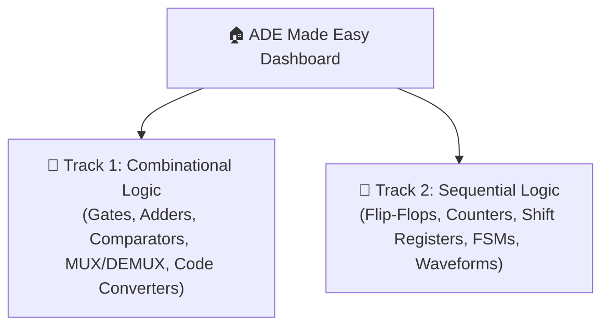
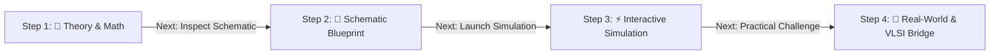
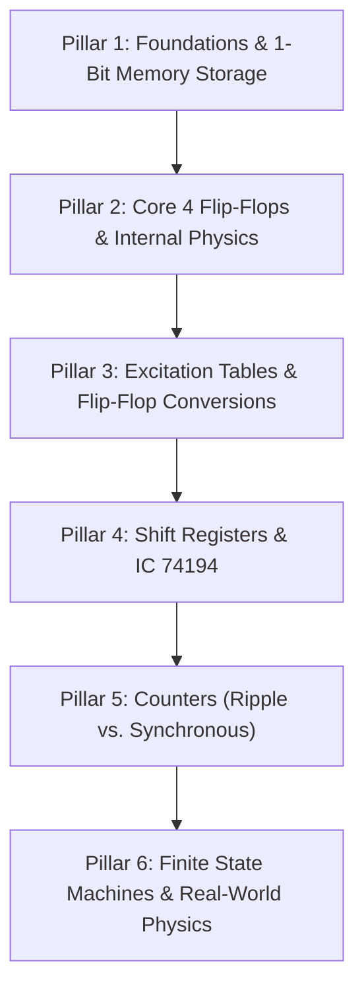

# 📐 ADE Made Easy — Approved Product Specification & Architecture

> **Tagline**: *"Master Analog & Digital Electronics from Concept to Silicon"*  
> **Target Audience**: Engineering Students (EnTC, ECE, EE, CSE) and Educators.  
> **Core Differentiator**: Bridges dry textbook theory with physical breadboard simulation and real-world semiconductor/embedded industry practice.

---

## 🏛️ 1. Dashboard Architecture: Two Hero Track Cards

Upon landing on the platform dashboard, students are presented with **Two Interactive Hero Track Cards**:



Each Track Card displays:
- **Module Count & IC List**:
  - *Track 1 (Combinational)*: 7400, 7404, 7408, 7432, 7483, 7485, 74151, 74153, 74184, 74185A.
  - *Track 2 (Sequential)*: 7474, 7476, 7490, 7493, 74160/74163, 74190/74191, 74194, 74279.
- **Completion Progress Bar**: Tracks completed steps across the student's cloud profile.
- **One-Click Launch**: Direct entry into any experiment or reference module in that track.

---

## 🧭 2. The Guided 4-Step Learning Wizard

Instead of an overwhelming single screen, each experiment follows an intuitive, progressive **4-Step Guided Flow**:



### 📖 Step 1: Theory & Foundations
- **Concise Core Concept**: High-yield theory without textbook clutter.
- **Interactive Tables**:
  - *Combinational*: Clickable Truth Tables highlighting active rows.
  - *Sequential*: Interactive **Excitation Table Solver** ($Q_n \rightarrow Q_{n+1}$ dynamically displays required inputs with Don't Cares $X$).
- **Pinout & IC Data**: Color-coded DIP-14/DIP-16 package pinout with active-low indicator notes.
- **Button**: `[ Continue to Schematic ➔ ]`

### 📐 Step 2: Schematic Blueprint
- **KiCad-Style Vector Schematic**: ANSI/IEEE standard logic gate symbols with exact IC pin numbers labeled.
- **Interactive Signal Traces**: Hovering over any signal wire highlights its entire net from source to destination.
- **Key Checkpoints**: Explanatory callouts pointing out pull-ups, ground pins, and active-low enables.
- **Button**: `[ Continue to Simulation Workbench ➔ ]`

### ⚡ Step 3: Interactive Simulation Workbench
- **Virtual IC Breadboard (60 FPS)**: The full interactive EDA simulation engine.
- **Stimulus Controls**: Logic toggle switches (0/1), manual/auto clock sources, VCC/GND rails.
- **Readout Indicators**: Logic probes and color LEDs reflecting live signal states.
- **Integrated Undo/Redo Engine**: `Ctrl+Z` / `Ctrl+Y` with toolbar buttons and HUD notifications.
- **Multi-Channel Real-Time Waveform Analyzer** *(Sequential Track)*: Live digital trace graphing Clock, Inputs, and Output bits over time.
- **Button**: `[ Continue to Real-World Practical Challenge ➔ ]`

### 🚀 Step 4: Actual Practical Use (The Industry Bridge)
A 4-part comprehensive practical suite:
1. **Real-World Scenario Challenge**:
   - Industry problem statements (e.g., *Automotive seatbelt buzzer using combinational gates*, *Elevator door timer FSM*, *UART serial-to-parallel shift register*).
   - Students adjust inputs to solve the real-world scenario.
2. **Synthesizable Verilog / VHDL RTL Generator**:
   - Generates production-ready Verilog code matching the drawn circuit.
   - Bridges student learning directly to FPGA and ASIC design.
3. **Hardware & Bench Reality Notes**:
   - Real-world physics: Switch contact bounce and debouncing circuits, floating input behavior, pull-up/pull-down resistor calculations, and IC fan-out limits.
4. **Embedded Systems & Microcontroller Interfacing**:
   - Pin-level wiring and code examples demonstrating how an **Arduino, STM32, or 8051** communicates with this TTL IC.

---

## ⚡ 3. The Sequential Logic Segment: 6 Essential Pillars

The **Sequential Logic Track** covers the complete curriculum required for university coursework, lab vivas, and professor presentations organized across 6 fundamental pillars:



### 🧱 Pillar 1: Foundations & 1-Bit Memory Storage
- **Combinational vs. Sequential Circuits**:
  - Combinational: Outputs depend strictly on current inputs ($Y = f(X)$). Zero memory, no feedback.
  - Sequential: Outputs depend on current inputs and past history ($Y = f(X, Q_n)$). Incorporates memory elements and feedback loops.
- **Synchronous vs. Asynchronous Systems**:
  - *Synchronous*: State transitions synchronized strictly by a global periodic clock signal ($CLK$). Glitch-free, deterministic.
  - *Asynchronous (Event-Driven)*: State changes triggered directly by signal transitions without a common clock. Faster in isolated paths, but prone to race conditions.
- **Latches vs. Flip-Flops**:
  - *Latches*: Level-triggered storage devices (transparent during active level).
  - *Flip-Flops*: Edge-triggered storage devices (sample data only on positive/negative clock edges: $\uparrow$ or $\downarrow$).
- **S-R Latch (NAND & NOR Implementations)**:
  - *Active-High (NOR)*: Cross-coupled NOR gates. $S=1 \implies Q=1$ (Set); $R=1 \implies Q=0$ (Reset); $S=R=0 \implies Q_n$ (Hold).
  - *Active-Low (NAND)*: Cross-coupled NAND gates. $\overline{S}=0 \implies Q=1$; $\overline{R}=0 \implies Q=0$; $\overline{S}=\overline{R}=1 \implies Q_n$.
  - **The Forbidden / Indeterminate State**:
    - For NOR Latch: $S=R=1 \implies Q = \overline{Q} = 0$ (violates complementary output). When both drop to 0 simultaneously, race condition ensues.
    - For NAND Latch: $\overline{S}=\overline{R}=0 \implies Q = \overline{Q} = 1$ (forbidden).
- **Asynchronous Override Controls**:
  - Active-Low **Preset ($\overline{Pr}$)** and **Clear ($\overline{Cr}$)**:
  - Wired directly into output NAND/NOR stages, bypassing the clock steering gates.
  - Provides instantaneous power-on initialization: $\overline{Pr}=0 \implies Q=1$; $\overline{Cr}=0 \implies Q=0$, regardless of clock or data inputs.

---

### 🔬 Pillar 2: The Core 4 Flip-Flops & Internal Physics
- **Clocked S-R Flip-Flop**:
  - Gated by clock enable.
  - Characteristic Equation: $Q_{n+1} = S + \overline{R}Q_n$ (Constraint: $S \cdot R = 0$).
- **J-K Flip-Flop (Universal Flip-Flop)**:
  - Eliminates the forbidden state by cross-feeding outputs back into inputs: $S = J\overline{Q}$, $R = KQ$.
  - The **Toggle State**: When $J=1, K=1$, $Q_{n+1} = \overline{Q}_n$.
  - Characteristic Equation: $Q_{n+1} = J\overline{Q}_n + \overline{K}Q_n$.
- **The Race-Around Condition** *(Top Viva Topic)*:
  - *Cause*: Occurs in level-triggered J-K latches when $J=1, K=1$, and the clock pulse width ($t_p$) exceeds the flip-flop propagation delay ($\Delta t$): $t_p > \Delta t$.
  - Output toggles uncontrollably multiple times during a single clock pulse, landing in an unpredictable state when clock drops LOW.
  - *Condition to Avoid Race-Around*: $t_p < \Delta t < T$ (where $T$ is the total clock period).
  - *Hardware Solutions*:
    1. Edge-triggered Flip-Flops (differentiating the clock into narrow spikes).
    2. **Master-Slave J-K Flip-Flop (IC 7476)**: Master samples on clock HIGH, Slave transfers to output on clock falling edge.
- **D-Type Flip-Flop (IC 7474 - Dual D with Preset/Clear)**:
  - Data / Delay Flip-Flop: Eliminates all illegal conditions by feeding $S = D$ and $R = \overline{D}$.
  - Characteristic Equation: $Q_{n+1} = D$.
- **T-Type Flip-Flop (Toggle Flip-Flop)**:
  - Constructed by shorting J and K together ($J = K = T$) or feeding $D = T \oplus Q_n$.
  - Characteristic Equation: $Q_{n+1} = T \oplus Q_n = T\overline{Q}_n + \overline{T}Q_n$.

---

### 🎯 Pillar 3: Excitation Tables & Flip-Flop Conversions (The Design Core)
- **Characteristic Table vs. Excitation Table**:
  - *Characteristic Table*: Maps Inputs $\implies$ Next State ($Q_{n+1}$). Used for circuit analysis.
  - *Excitation Table*: Maps Present State to Desired Next State ($Q_n \rightarrow Q_{n+1}$) $\implies$ Required Inputs. Essential for counter and state machine synthesis.
- **The Master Excitation Table**:

| Present State ($Q_n$) | Next State ($Q_{n+1}$) | S | R | J | K | D | T |
| :---: | :---: | :---: | :---: | :---: | :---: | :---: | :---: |
| **0** | **0** | 0 | X | 0 | X | 0 | 0 |
| **0** | **1** | 1 | 0 | 1 | X | 1 | 1 |
| **1** | **0** | 0 | 1 | X | 1 | 0 | 1 |
| **1** | **1** | X | 0 | X | 0 | 1 | 0 |

- **Universal Flip-Flop Conversion Algorithm (3-Step Procedure)**:
  1. *Step 1*: Write the Truth/Characteristic Table of the Target Flip-Flop.
  2. *Step 2*: Append the Excitation Table inputs of the Available (Given) Flip-Flop for every ($Q_n \rightarrow Q_{n+1}$) transition.
  3. *Step 3*: Solve K-Maps for each Available input in terms of Target inputs and $Q_n$.
- **Solved Core Conversions**:
  - **JK to D**: $J = D$, $K = \overline{D}$ (via an inverter).
  - **JK to T**: $J = T$, $K = T$ (inputs tied together).
  - **SR to JK**: $S = J\overline{Q}_n$, $R = KQ_n$ (AND gates with feedback).

---

### 🔄 Pillar 4: Shift Registers & IC 74194
- **The 4 Fundamental Operating Modes**:
  - **SISO (Serial-In Serial-Out)**: Data shifts 1 bit per clock pulse. Used as Digital Delay Lines with delay $\Delta t = N / f_c$.
  - **SIPO (Serial-In Parallel-Out)**: Serial stream converted to $N$-bit parallel word. Used in Deserializers, UART Receivers, and SPI slaves.
  - **PISO (Parallel-In Serial-Out)**: Broadside parallel data loaded and shifted out bit-by-bit. Used in Serializers, UART Transmitters.
  - **PIPO (Parallel-In Parallel-Out)**: Instantaneous parallel load and parallel read. Used for high-speed CPU bus registers.
- **IC 74194 Universal Shift Register**:
  - 4-bit bidirectional register with asynchronous master reset ($\overline{MR}$).
  - Control Mode Select inputs:
    - $S_1 S_0 = 00 \implies$ **Hold (No Change)**
    - $S_1 S_0 = 01 \implies$ **Shift Right (Serial In: $SR\_SER$)**
    - $S_1 S_0 = 10 \implies$ **Shift Left (Serial In: $SL\_SER$)**
    - $S_1 S_0 = 11 \implies$ **Parallel Load ($D_0, D_1, D_2, D_3$)**
- **Ring Counter**:
  - Circulating single logic '1' through $N$ flip-flops ($Q_0 \rightarrow D_{in}$).
  - Number of states = $N$. Unused states = $2^N - N$.
  - Applications: Multiphase non-overlapping clock generation, stepper motor phase sequencing.
- **Johnson (Twisted-Ring) Counter**:
  - Inverted feedback: $\overline{Q}_N \rightarrow D_0$.
  - Number of states = $2N$ (doubles the state capacity without extra flip-flops).
  - Self-decoding: Glitch-free decoding using single 2-input AND gates for each state.

---

### ⏱️ Pillar 5: Counters (Ripple vs. Synchronous)
- **Asynchronous (Ripple) Counters**:
  - Clock applied only to LSB; each subsequent flip-flop clocked by the output of the preceding stage ($Q$ or $\overline{Q}$).
  - *Cumulative Propagation Delay*: $t_{\text{total}} = N \cdot t_{pd}$.
  - *Maximum Operating Frequency*:
    $$f_{max} \le \frac{1}{N \cdot t_{pd} + T_s}$$
  - *Decoding Glitches / Spikes*: Transitional intermediate states (e.g., $011 \rightarrow [010 \rightarrow 000] \rightarrow 100$) produce spurious spikes in combinational decoders.
  - **IC 7490 (BCD Decade Counter)**:
    - Independent Divide-by-2 ($CLK_A \rightarrow Q_A$) and Divide-by-5 ($CLK_B \rightarrow Q_B, Q_C, Q_D$).
    - Cascaded for Mod-10 natural BCD ($0000_2$ to $1001_2$) by wiring $Q_A \rightarrow CLK_B$.
    - Truncated Mod-6 reset: Feedback $Q_C \cdot Q_B$ into active-high reset pins $R_{0(1)}, R_{0(2)}$.
  - **IC 7493 (4-Bit Binary Counter)**:
    - Divide-by-2 and Divide-by-8 sections.
    - Cascaded for Mod-16 ($0000_2$ to $1111_2$) by wiring $Q_A \rightarrow CLK_B$.
    - Truncated Mod-12 reset: Feedback $Q_D \cdot Q_C$ into reset pins $R_{0(1)}, R_{0(2)}$.
- **Synchronous Counters**:
  - Global clock connected simultaneously to all flip-flop clock pins.
  - No cumulative ripple delay; high operating speed; eliminates decoding glitches.
  - *Design Procedure*: State Diagram $\rightarrow$ State Table $\rightarrow$ Flip-Flop Excitation Mapping $\rightarrow$ K-Maps $\rightarrow$ Gate Logic.
  - **3-Bit Synchronous UP Counter Design**:
    - Flip-Flop 0 (LSB): $J_0 = K_0 = 1$ (toggles every clock)
    - Flip-Flop 1: $J_1 = K_1 = Q_0$
    - Flip-Flop 2 (MSB): $J_2 = K_2 = Q_0 \cdot Q_1$
  - **Synchronous UP/DOWN Counter**: Mode control $M$ switches steering between $Q$ (UP) and $\overline{Q}$ (DOWN):
    $$J_i = K_i = (M \cdot \prod Q) + (\overline{M} \cdot \prod \overline{Q})$$
  - **Presettable MSI Counters**:
    - **IC 74160 / 74163**: 4-bit Synchronous BCD / Binary Counters with synchronous parallel load and carry lookahead ($RCO$).
    - **IC 74190 / 74191**: Up/Down Synchronous BCD / Binary Counters with single clock input and direction pin.

---

### ⚙️ Pillar 6: Finite State Machines (FSMs) & Real-World Physics
- **FSM Architecture Models**:
  - **Mealy Machine**: Output = $f(\text{Present State}, \text{Current Inputs})$.
    - Requires fewer states.
    - Asynchronous output changes can glitch when inputs change between clock edges.
  - **Moore Machine**: Output = $f(\text{Present State})$.
    - Outputs synchronized strictly with the clock edge; glitch-free.
    - May require more states than an equivalent Mealy machine.
- **FSM Synthesis Workflow**:
  $$\text{Word Specification} \longrightarrow \text{State Diagram} \longrightarrow \text{State Table} \longrightarrow \text{State Reduction} \longrightarrow \text{State Assignment} \longrightarrow \text{Excitation K-Maps} \longrightarrow \text{Schematic}$$
- **Sequence Detector Design**:
  - Detects serial bit pattern (e.g. `1010`).
  - *Overlapping*: Sequence `101010` produces 2 output pulses.
  - *Non-Overlapping*: Sequence `101010` produces 1 output pulse and resets search.
- **VLSI Timing Specifications**:
  - **Setup Time ($t_s$)**: Minimum time data input must remain stable *before* the active clock edge.
  - **Hold Time ($t_h$)**: Minimum time data input must remain stable *after* the active clock edge.
  - **Metastability**: Undefined logic state ($V_{out} \approx V_{DD}/2$) oscillating unpredictably when $t_s$ or $t_h$ is violated. Solved using dual-stage synchronizer flip-flops.
  - **Clock Skew ($\Delta t_{skew}$)**: Arrival time difference of the clock edge at different flip-flops. Hold violation avoided when:
    $$t_{\text{prop(min)}} \ge t_{\text{hold}} + \Delta t_{skew}$$
- **Real-World Engineering Implementations**:
  - **SPDT Switch Debouncer**: Eliminates 5–20 ms mechanical spring bounce using a cross-coupled SR latch (IC 74279).
  - **1-Bit Static RAM (SRAM) Cell**: Cross-coupled inverters with NMOS pass transistors controlled by Word Line ($WL$) and Bit Lines ($BL, \overline{BL}$).
  - **4-Phase Stepper Motor Controller**: Ring counter generating wave drive (`1000 -> 0100 -> 0010 -> 0001`) driving power Darlington transistors (ULN2003).

---

## 📜 4. Antigravity System Configuration (Ready for `AGENTS.md`)

```markdown
# Project: ADE Made Easy
## Tagline: Master Analog & Digital Electronics from Concept to Silicon

## Product Architecture:
- Two Distinct Segment Tracks:
  1. Combinational Logic (Gates, Adders, Comparators, Multiplexers, Code Converters)
  2. Sequential Logic (6 Pillars: Latches, Flip-Flops, Excitation Tables, Shift Registers, Counters, FSMs)
- 4-Step Guided Pedagogical Flow:
  - Step 1: Theory (Equations, Interactive Truth/Excitation Tables, K-Maps, Pinouts)
  - Step 2: Schematic Blueprint (ANSI/IEEE Schematic, Net Tracing, Pin Labels)
  - Step 3: Simulation Workbench (Virtual Breadboard, ICs, Waveform Scope, Undo/Redo)
  - Step 4: Actual Practical Use (Real-World Challenges, Verilog RTL, Hardware Physics, MCU Interfacing)

## Tech Stack:
- Frontend: HTML5, CSS3, Vanilla ES6+ Canvas & SVG, 4-Step Wizard Stepper
- Backend: Python 3.10+ with FastAPI, Uvicorn, Pydantic v2
- Database: Dual-Engine (SQLite local `backend/users.db`, Neon PostgreSQL cloud via `DATABASE_URL`)
- Auth: JWT Bearer Tokens, Salted Passwords, Student Roll Number & Email Identifiers
```
