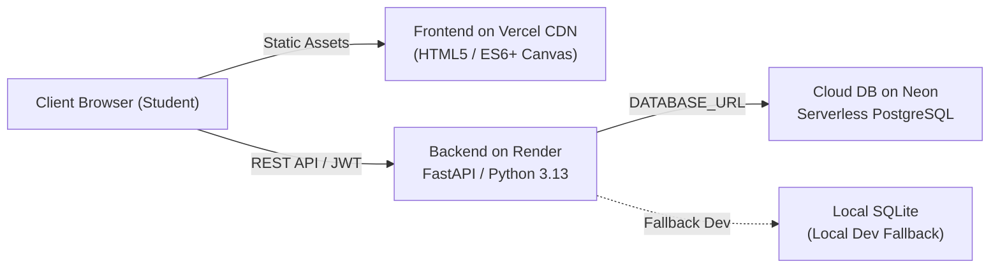
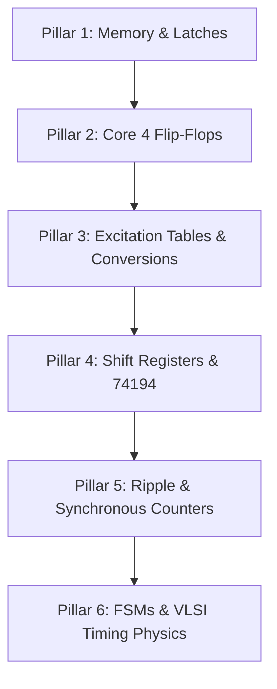

# ADE Made Easy — Project History & Technical Handoff

> **Vision & Tagline:** *"Master Analog & Digital Electronics from Concept to Silicon"*

---

## 1. Executive Summary

**ADE Made Easy** (evolved from the Digital Logic Simulation Suite) is an interactive Electronic Design Automation (EDA) simulation suite and academic learning platform. The application provides digital and analog electronics students and circuit designers with an end-to-end laboratory workbench directly in the browser—combining 60 FPS real-time breadboard wiring, standard TTL 74LSxx IC logic emulation, dynamic schematic generation, observation logging, and cloud project synchronization.

This document serves as the project memory and technical handoff base, capturing:
- All 12 implemented lab experiment presets and EDA capabilities
- Live production deployment endpoints across Vercel, Render, and Neon PostgreSQL
- The engineering roadmap for Phase 2 expansion

---

## 2. Complete Inventory of Implemented IC Presets (12 Experiments)

The Workbench (`frontend/workbench.html` & `frontend/workbench.js`) features 12 turnkey, pre-wired academic lab experiment presets that initialize components, power rails, clock inputs, signal switches, and output LED indicators:

| Preset Key | Experiment Title | Primary ICs / Components | Functional Description & Pin Wiring |
| :--- | :--- | :--- | :--- |
| `7400_nand` | **Exp 1: 7400 Quad 2-Input NAND Gate Verification** | 7400 Quad NAND, Power Rail, SPDT Switches, Output LED | Verifies universal NAND logic truth table ($Y = \overline{A \cdot B}$). Inputs on pins 1 & 2, output on pin 3. Pin 14 tied to VCC, pin 7 tied to GND. |
| `7483_adder` | **Exp 2: 7483 4-Bit Binary Full Adder Test** | 7483 4-Bit Adder, 8-Input Switch Bank, 8-Channel LED Rail | Computes 4-bit binary addition $(A_3..A_0 + B_3..B_0 + C_0)$ yielding sum $(\Sigma_4..\Sigma_1)$ and carry out $(C_4)$. Pin 5 tied to VCC, pin 12 tied to GND. |
| `7485_comparator` | **Exp 3: 7485 4-Bit Magnitude Comparator Test** | 7485 4-Bit Comparator, 8-Input Switch Bank, 3 Indicator LEDs | Compares two 4-bit binary words $A$ and $B$, driving outputs $A>B$ (Pin 5), $A=B$ (Pin 6), and $A<B$ (Pin 7). Cascading inputs configured with $I_{A=B}$ pulled HIGH. |
| `74151_mux` | **Exp 4: 74151 8:1 Multiplexer Experiment** | 74151 8:1 MUX, 8 Data Switches, 3 Select Switches, Output LEDs | Selects one of 8 data lines ($D_0-D_7$) using 3-bit binary select address $(S_2, S_1, S_0)$. Active-low strobe $\overline{E}$ on pin 7. Complementary outputs $Y$ (Pin 5) and $W = \overline{Y}$ (Pin 6). |
| `74153_mux` | **Exp 5: 74153 Dual 4:1 Multiplexer Experiment** | 74153 Dual 4:1 MUX, Data Inputs, Shared Select Lines, LEDs | Demonstrates dual independent 4-to-1 data multiplexing. Common select lines $S_1, S_0$ control channel 1 ($1I_0-1I_3 \rightarrow 1Y$) and channel 2 ($2I_0-2I_3 \rightarrow 2Y$) with independent active-low strobes $1\overline{G}, 2\overline{G}$. |
| `74153_case1_3var` | **Exp 6: 74153 8:1 MUX: $F(C,B,A) = \Sigma m(0,1,3,4,7)$** | 74153 Dual 4:1 MUX, Strobe Inverter, Switch Bank, Output LED | Academic Lab Case 1: Implements a 3-variable Boolean minterm function by partitioning variables into select lines ($B, A$) and data input logic ($C, \overline{C}, 0, 1$). |
| `74153_8to1_function` | **Exp 7: 74153 8:1 MUX: $F(A,B,C,D) = \Sigma m(0,1,2,4,7,8,9,11,12,14)$** | 74153 Dual 4:1 MUX, NOT Gate (7404), Logic Rail, Output LED | Academic Lab Case 2: Synthesizes a 4-variable Boolean logic function using dual 4:1 multiplexers and select line decoding. |
| `diode_or` | **Exp 8: Diode OR Logic Gate Circuit** | 1N4148/1N4007 Diodes, SPDT Switches, 1kΩ Resistor, LED | Discrete component electronics experiment showing diode forward conduction logic ($V_{out} = V_{in} - V_D$) implementing an OR gate with pull-down resistor to GND. |
| `7490_decade` | **Exp 9: 7490 BCD Decade Counter (Mod-10, 0..9)** | 7490 Decade Counter, Clock Generator, 8-Channel LED Rail | Asynchronous BCD decade counter. Output $Q_A$ (Pin 12) cascades to input $B$ (Pin 1). Counts 0000 to 1001 (0 to 9 decimal). Reset lines $R_{0(1)}, R_{0(2)}, R_{9(1)}, R_{9(2)}$ tied to GND. |
| `7490_mod6` | **Exp 10: 7490 Mod-6 Counter (Reset at 6: $Q_C \cdot Q_B$)** | 7490 Decade Counter, Feedback Wires, Clock Generator, LED Rail | Truncated modulo-6 asynchronous counter (counts 0 to 5). State 6 ($0110_2$) feedback loop ties $Q_C$ (Pin 8) to $R_{0(1)}$ (Pin 2) and $Q_B$ (Pin 9) to $R_{0(2)}$ (Pin 3) for instant zero-reset. |
| `7493_mod16` | **Exp 11: 7493 4-Bit Binary Counter (Mod-16, 0..15)** | 7493 4-Bit Binary Counter, Clock Generator, LED Rail | Modulo-16 ripple counter. Output $Q_A$ (Pin 12) feeds Clock input $B$ (Pin 1). Cycles through all 16 states ($0000_2$ to $1111_2$). Reset inputs $R_{0(1)}, R_{0(2)}$ tied to GND. |
| `7493_mod12` | **Exp 12: 7493 Mod-12 Counter (Reset at 12: $Q_D \cdot Q_C$)** | 7493 4-Bit Binary Counter, Feedback Wires, Clock Generator, LED Rail | Truncated modulo-12 counter (counts 0 to 11). State 12 ($1100_2$) feedback loop routes $Q_D$ (Pin 11) to $R_{0(1)}$ (Pin 2) and $Q_C$ (Pin 8) to $R_{0(2)}$ (Pin 3) for immediate reset. |

---

## 3. Implemented EDA Simulation & Workbench Features

### A. Core Simulation Engine
- **60 FPS Client-Side Simulation**: Interactive loop written in pure ES6+ JavaScript, computing real-time logic propagation without server roundtrips.
- **Three-State Logic & Signal Levels**: Fully tracks logic HIGH ($1$), logic LOW ($0$), and FLOATING/HIGH-Z ($Z$) states across all pins and nets.
- **Clock Generator Pulse Engine**: Configurable frequency generator (variable Hz) and single-step manual pulse button for stepping through sequential transitions.

### B. Interactive Canvas & Wiring System
- **SVG Breadboard Workbench**: Scalable vector rendering with responsive zoom, panning, and reset-zoom controls.
- **Orthogonal Wire Routing**: Automatic Manhattan/orthogonal routing with wire tension, customizable color palettes, and wire deletion tools.
- **Pin Snapping & Tooltips**: Snapping hotspots on DIP IC pins, switches, and LED rails with live pin labels and voltage indicators.

### C. Laboratory Productivity Tools
- **Full Undo / Redo History**: Complete state snapshots allowing frictionless undo (`Ctrl+Z`) and redo (`Ctrl+Y`).
- **Dynamic KiCad-Style Schematic Viewer**: Translates breadboard connections into standardized schematic symbols and netlists.
- **Observation Report & PDF Lab Manual Generator**: Automatically exports student lab reports with truth table logs, roll numbers, timestamped circuit diagrams, and faculty signature blocks.
- **JSON Import / Export**: Portable circuit file format for sharing, backup, and grading.

### D. Academic Authentication & Cloud Persistence
- **Dual-Engine Database Layer**: SQLite for zero-config local development (`backend/users.db`) and PostgreSQL for cloud production (Neon).
- **Academic Roll Number Login**: Students sign in via College Roll Number (e.g., `23CS012`) or institutional email with salted PBKDF2/SHA-256 passwords and OTP verification.
- **Dual-Tier Cloud Circuit Sync**: Instant offline caching in `localStorage` backed by authenticated PostgreSQL cloud persistence (`user_circuits` table) with full CRUD operations.

---

## 4. Live Deployment Topology & Production Endpoints

| Component | Target Platform | Live Endpoint / Config | Details |
| :--- | :--- | :--- | :--- |
| **Frontend** | **Vercel** | Configured via `vercel.json` | Static CDN delivery, URL rewrites to `/landing.html`, strict security headers (`nosniff`, `SAMEORIGIN`, `strict-origin-when-cross-origin`). |
| **Backend API** | **Render** | `https://logic-sim-suite.onrender.com` | FastAPI modular REST API running on Python 3.13 (`render.yaml`). Automatic OpenAPI documentation at `/docs` and `/redoc`. |
| **Database** | **Neon PostgreSQL** | Project: `bold-poetry-01774125` Branch: `production` | Serverless PostgreSQL with auto-suspend and connection pooling (`.neon` config). Automatic migrations executed via `backend/database.py`. |
| **Local Dev** | **SQLite** | `backend/users.db` | Local zero-dependency database automatically activated when `DATABASE_URL` is empty. |

---

## 5. Phase 2 Engineering Roadmap

The upcoming engineering phase expands **ADE Made Easy** from combinational logic and basic ripple counters into full sequential systems, timing instrumentation, and analog circuits structured across **6 Essential Pillars**:

### Pillar 1: Foundations & 1-Bit Memory Storage
- **Combinational vs. Sequential Circuits**: Zero-memory stateless networks ($Y = f(X)$) vs. history-dependent bistable systems with memory elements and feedback loops ($Y = f(X, Q_n)$).
- **Synchronous vs. Asynchronous Systems**: Periodic global clock-driven transitions vs. event-driven ripple propagation.
- **Latches vs. Flip-Flops**: Level-triggered transparent latches vs. edge-triggered bistables sampling on clock transitions ($\uparrow$ or $\downarrow$).
- **S-R Latch (NAND & NOR Implementations)**:
  - Active-HIGH (NOR): $S=1 \implies Set$, $R=1 \implies Reset$, $S=R=0 \implies Hold$. Forbidden state: $S=R=1 \implies Q=\overline{Q}=0$.
  - Active-LOW (NAND): $\overline{S}=0 \implies Set$, $\overline{R}=0 \implies Reset$, $\overline{S}=\overline{R}=1 \implies Hold$. Forbidden state: $\overline{S}=\overline{R}=0 \implies Q=\overline{Q}=1$.
- **Asynchronous Override Controls**: Active-low Preset ($\overline{Pr}$) and Clear ($\overline{Cr}$) directly override internal clock-steering gates for instantaneous power-on initialization.

### Pillar 2: The Core 4 Flip-Flops & Internal Physics
- **Clocked S-R Flip-Flop**: Characteristic equation: $Q_{n+1} = S + \overline{R}Q_n$ (Constraint: $S \cdot R = 0$).
- **J-K Flip-Flop (Universal Element)**: Eliminates forbidden state via feedback ($S = J\overline{Q}$, $R = KQ$). Toggle state: $J=K=1 \implies Q_{n+1} = \overline{Q}_n$. Characteristic equation: $Q_{n+1} = J\overline{Q}_n + \overline{K}Q_n$.
- **The Race-Around Condition (Top Viva Topic)**:
  - Cause: In level-triggered JK latches with $J=K=1$, clock pulse width exceeds internal propagation delay ($t_p > \Delta t$), triggering uncontrollable oscillation.
  - Condition to avoid: $t_p < \Delta t < T$.
  - Solutions: Edge-triggered differentiation and Master-Slave J-K Flip-Flops (**IC 7476**).
- **D-Type Flip-Flop (IC 7474)**: Data/Delay latch ($Q_{n+1} = D$).
- **T-Type Flip-Flop**: Toggle element ($Q_{n+1} = T \oplus Q_n$).

### Pillar 3: Excitation Tables & Flip-Flop Conversions (The Design Core)
- **Characteristic vs. Excitation Tables**: Forward state prediction ($Inputs \rightarrow Q_{n+1}$) vs. synthesis transition mapping ($Q_n \rightarrow Q_{n+1} \rightarrow Required Inputs$).
- **The Master Excitation Table**:
  - $0 \rightarrow 0: S=0, R=X \mid J=0, K=X \mid D=0 \mid T=0$
  - $0 \rightarrow 1: S=1, R=0 \mid J=1, K=X \mid D=1 \mid T=1$
  - $1 \rightarrow 0: S=0, R=1 \mid J=X, K=1 \mid D=0 \mid T=1$
  - $1 \rightarrow 1: S=X, R=0 \mid J=X, K=0 \mid D=1 \mid T=0$
- **Universal 3-Step Flip-Flop Conversion Algorithm**: Target truth table $\rightarrow$ Available excitation mapping $\rightarrow$ Drive K-Maps (JK to D, JK to T, SR to JK).

### Pillar 4: Shift Registers & IC 74194
- **4 Operating Modes**:
  - **SISO**: Digital delay lines with delay $\Delta t = N / f_c$.
  - **SIPO**: Serial deserializers, UART & SPI receivers.
  - **PISO**: Parallel serializers, UART & SPI transmitters.
  - **PIPO**: High-speed CPU data bus registers.
- **IC 74194 4-Bit Bidirectional Universal Shift Register**: Control pins $S_1 S_0$: $00$ Hold, $01$ Shift Right, $10$ Shift Left, $11$ Parallel Load.
- **Ring Counter**: Circulating single logic '1' across $N$ flip-flops ($N$ states, multiphase clock generation).
- **Johnson (Twisted-Ring) Counter**: Inverted feedback ($\overline{Q}_0 \rightarrow D_{in}$) providing $2N$ states with glitch-free 2-input AND decoding.

### Pillar 5: Counters (Ripple vs. Synchronous)
- **Asynchronous (Ripple) Counters**: Cascaded clocking, cumulative propagation delay ($t_{total} = N \cdot t_{pd}$), frequency limit ($f_{max} \le \frac{1}{N \cdot t_{pd} + T_s}$), and decoding spikes.
  - **IC 7490 Decade Counter**: Mod-10 natural BCD and truncated Mod-6 ($Q_C \cdot Q_B = 1$).
  - **IC 7493 4-Bit Binary Counter**: Mod-16 natural binary and truncated Mod-12 ($Q_D \cdot Q_C = 1$).
- **Synchronous Counters**: Simultaneous clocking, high-speed glitch-free operation.
  - **3-Bit Synchronous UP Counter**: $J_0 = K_0 = 1$, $J_1 = K_1 = Q_0$, $J_2 = K_2 = Q_0 \cdot Q_1$.
  - **Synchronous UP/DOWN Counter**: Direction control mode $M$.
  - **Presettable MSI Counters**: IC 74160/74163 (Sync BCD/Binary), IC 74190/74191 (Sync Up/Down).

### Pillar 6: Finite State Machines (FSMs) & Real-World Physics
- **FSM Models**: Mealy ($Output = f(State, Inputs)$) vs. Moore ($Output = f(State)$, glitch-free).
- **FSM Synthesis Workflow**: State diagram $\rightarrow$ State table $\rightarrow$ State reduction $\rightarrow$ State assignment $\rightarrow$ K-Maps $\rightarrow$ Logic circuit.
- **Sequence Detector Design**: Serial bit stream detection (`1010` overlapping vs. non-overlapping).
- **VLSI Timing Specifications**: Setup time ($t_s$), Hold time ($t_h$), Metastability, Clock Skew ($\Delta t_{skew}$), and hold violation prevention: $t_{\text{prop(min)}} \ge t_{\text{hold}} + \Delta t_{skew}$.
- **Real-World Implementations**:
  - **SPDT Switch Debouncer**: Eliminates 5–20 ms mechanical chatter via cross-coupled SR latch (IC 74279).
  - **1-Bit SRAM 6T Cell**: Cross-coupled inverters with Word Line ($WL$) and Bit Lines ($BL, \overline{BL}$).
  - **4-Phase Stepper Motor Controller**: Ring counter generating wave drive sequence (`1000 -> 0100 -> 0010 -> 0001`) driving power Darlington transistors (ULN2003).
